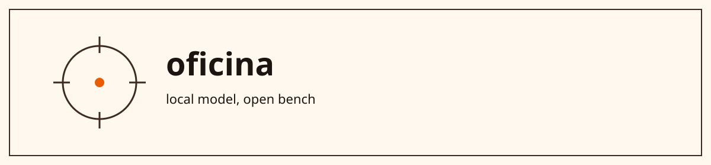

# Lucas Noblat

> A duck did not ask for YOLO. It got one anyway: the model runs in the browser, and the shot fires itself.

**Role:** Senior Applied AI Engineer at LettrLabs  
**Language:** English  
**Contact:** contactlucasnoblat@gmail.com · https://github.com/lcsnoblat

## Open bench

| Piece | What you get if you open it | Credit |
| --- | --- | --- |
| [duckhunt-js](https://github.com/lcsnoblat/duckhunt-js) | A JS/HTML5 Duck Hunt. A Web Worker runs YOLOv5 with TensorFlow.js and returns each duck's center for the shot. MIT. | Course module, "Engenharia de IA Aplicada". Own work: the agent and the integration. Not mine: the game and the model. |
| [sear-4](https://github.com/lcsnoblat/sear-4) | First cut of a local web surface for an AI infrastructure / DevOps portfolio, with 3D visibility. | Own draft. No public demo and no usage number to cite. |

Left on the bench, not pinned

The joke stops at the evidence. A course, a fork, or a challenge is not a case study.

`fem-fd-service` is a Frontend Masters course companion with a proprietary license. `caju-challenge` is a technical challenge. Forks, not mine: `pokedex`, `interview-accountapi`, `tech-challenge`. `lcsnoblat.github.io` is a 2017 user site, not this bench.

Existing URLs stay. A new repo, if any, uses kebab-case and may take a `lab-` prefix only when it is an experiment.

